# Greybox → Multistyle Art Showcases

同一套可玩灰盒，制作多种视觉风格。这里收集 **4个游戏、18个美术开发候选**的可编辑 Godot 工程，以及共享灰盒、方案图、粗模与试装过程材料。

**[下载完整工程与资源](https://github.com/hbzheng0942/greybox-to-multistyle-art-showcases/releases/latest)** · [机器可查询目录](catalog.json) · [后续 Agent 交接](docs/AGENT_HANDOFF.md) · [资源与授权说明](NOTICE.md)

当前完整资源正在分片上传，首次Release尚未公开。源码、风格截图与过程目录已可浏览；完整包经云端哈希校验后开放下载。

[已有录制素材与版本说明](media/README.md) · [同事录制指南](docs/RECORDING_GUIDE.md)

`main` 分支提供源码、截图和索引；**完整 Release 压缩包包含运行与编辑所需模型、纹理、音频**。GitHub 的 Source code ZIP 不含大资源。这里的“开发候选”表示当前工程，人工美术、玩法与性能验收另行记录。

## 按游戏查找

| 游戏 | 本次收录 | 其他制作方向与进度 | 工程说明 |
|---|---:|---|---|
| Hole 黑洞 | 11种风格 | 旧滨水版、概念与单槽试装未混入 | [入口、操作与验证](games/hole/GAME.md) |
| 列车跑酷 | 5种风格 | 共开展7个方向；A1局部样段、被否决赛璐璐全场不收录 | [入口、操作与验证](games/train-parkour/GAME.md) |
| 狗闹博物馆 | A01＋共享灰盒 | A04/A08排队；骨骼动画部分完成，详见集成记录 | [工程与动画状态](games/museum-dog/GAME.md) |
| Bubble Buddies | 新D1＋v9灰盒 | 新D2–D4排队；旧线4个方向仅资格试装 | [两条制作线与入口](games/bubble-buddies/GAME.md) |

流程录制材料按阶段查找：[Hole](games/hole/process/INDEX.md) · [列车跑酷](games/train-parkour/process/INDEX.md) · [博物馆](games/museum-dog/process/INDEX.md) · [Bubble](games/bubble-buddies/process/INDEX.md)。索引区分方案图、程序化灰盒、结构粗模、真实资产试装和当前成果，并链接可编辑文件。

## Hole：11个风格

图片为对应风格的原生开发截图；各版本与当前包技术验证见 [styles.json](games/hole/styles.json)。全部仍待人工终验。

| 风格 | 当前版本 / 进度 | 截图 |
|---|---|---|
| [游乐园](games/hole/styles/amusement/project/project.godot) | small-props / 可玩候选 | 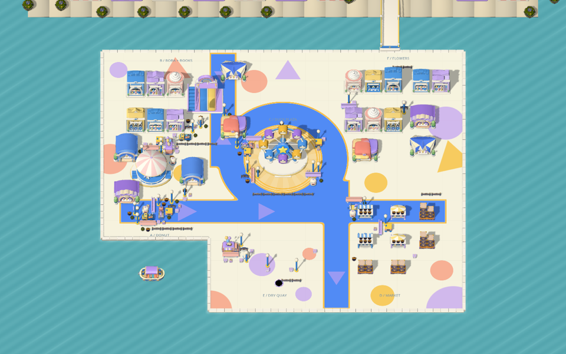 |
| [零食店](games/hole/styles/snack/project/project.godot) | small-props / 可玩候选 | 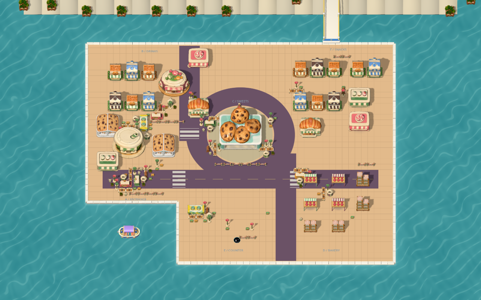 |
| [蘑菇森林](games/hole/styles/mycelium/project/project.godot) | five-worlds完整版本 / 可玩候选 | 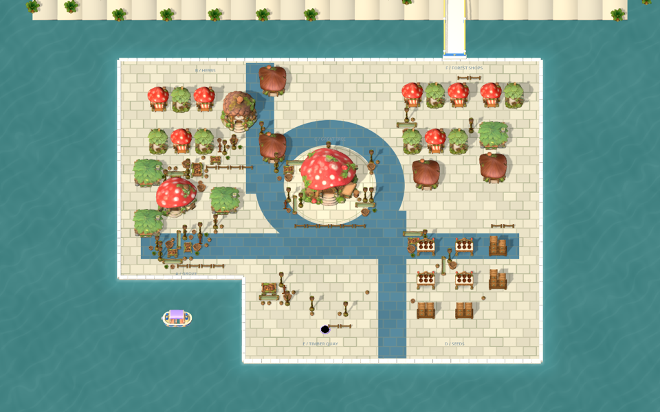 |
| [月面基地](games/hole/styles/lunar/project/project.godot) | five-worlds / 可玩候选 | 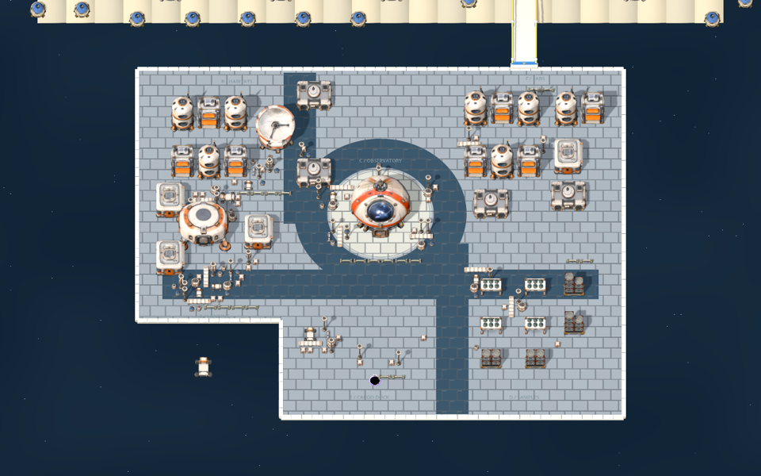 |
| [珊瑚海集市](games/hole/styles/coral/project/project.godot) | five-worlds / 可玩候选 | 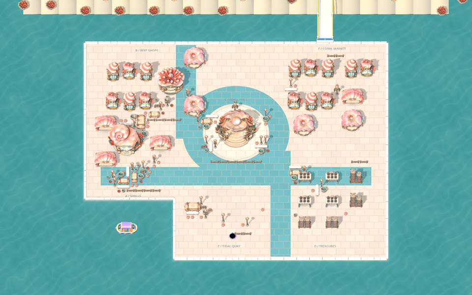 |
| [沙漠商队](games/hole/styles/saffron/project/project.godot) | five-worlds / 可玩候选 | 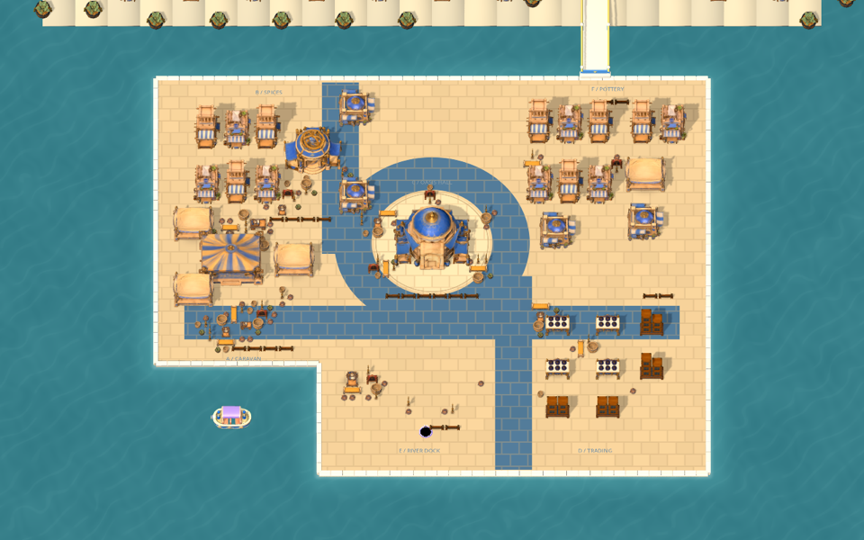 |
| [纸艺雪镇](games/hole/styles/papercraft/project/project.godot) | five-worlds / 可玩候选 | 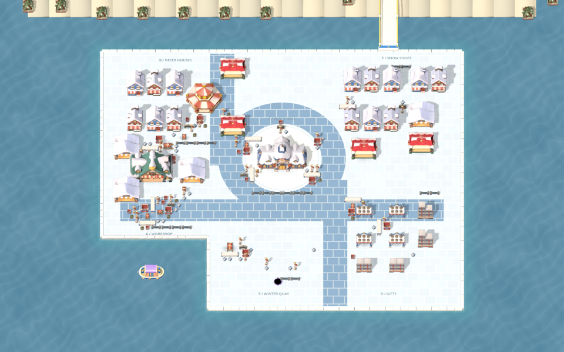 |
| [国风漫画](games/hole/styles/comic/project/project.godot) | 确定性全场装配 / 可玩候选 | 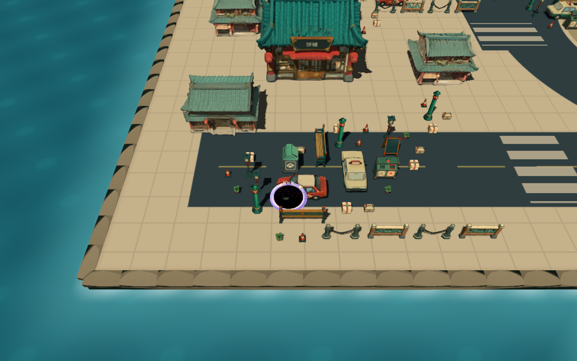 |
| [复古搪瓷](games/hole/styles/enamel/project/project.godot) | 确定性全场装配 / 可玩候选 | 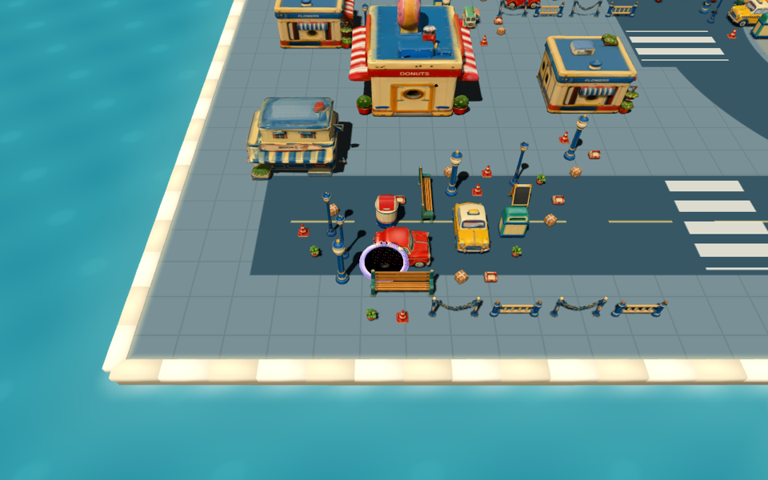 |
| [糖果陶瓷](games/hole/styles/ceramic/project/project.godot) | lookdev combined / 开发alpha | 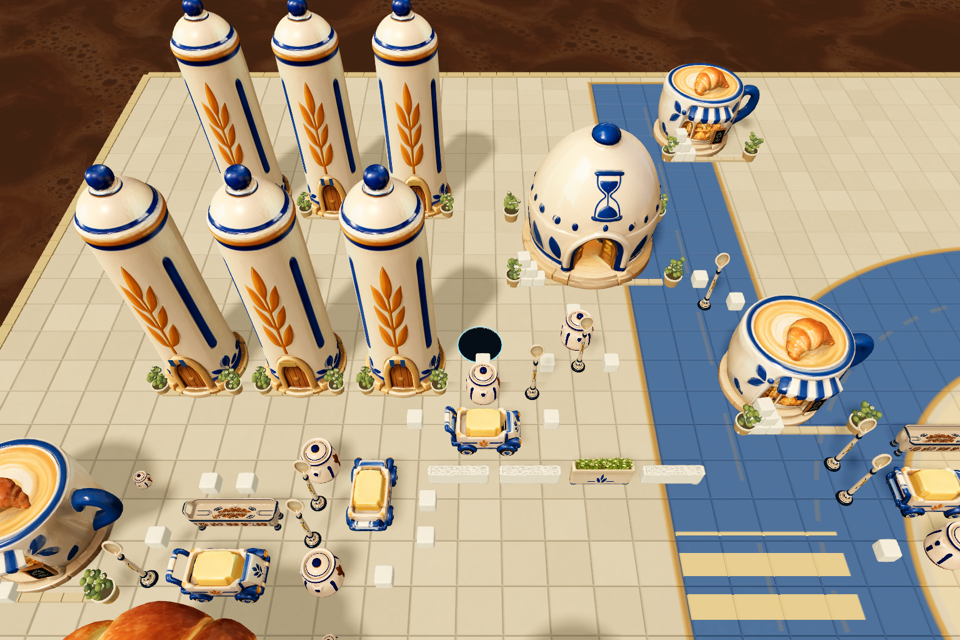 |
| [轨道科幻](games/hole/styles/orbital/project/project.godot) | lookdev combined / 开发alpha | 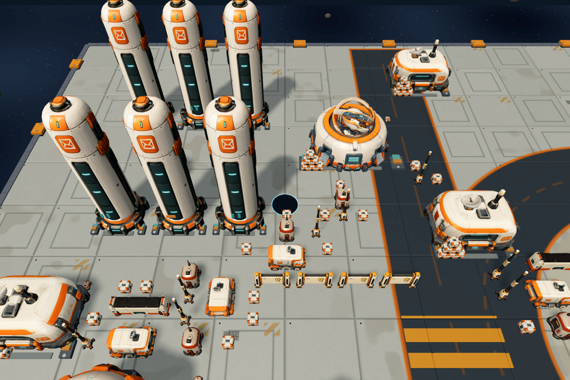 |

## 列车跑酷：5个风格

长场景的工程启动与路线完整性检查，和实时帧率、美术终验分别记录。B2保留已验证录制使用的Vulkan路线。

| 风格 | 当前版本 / 进度 | 截图 |
|---|---|---|
| [彩色黏土](games/train-parkour/styles/clay/) | P21 / 可玩候选 | 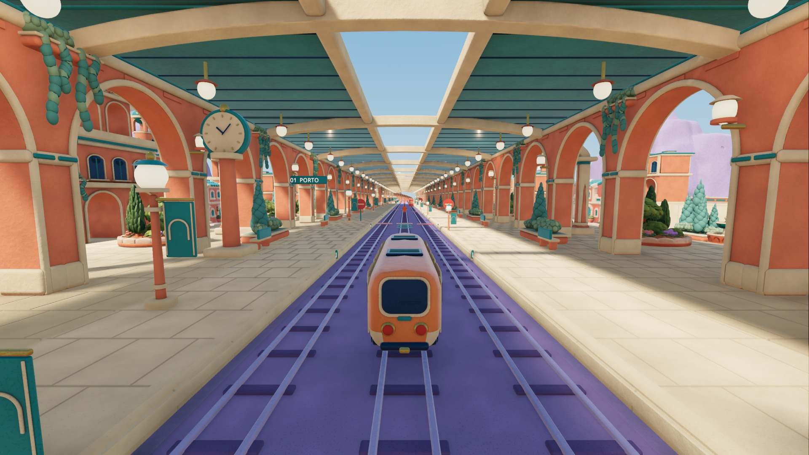 |
| [像素天际线](games/train-parkour/styles/pixel-v2/) | V2全线收尾 / 7节点候选 | 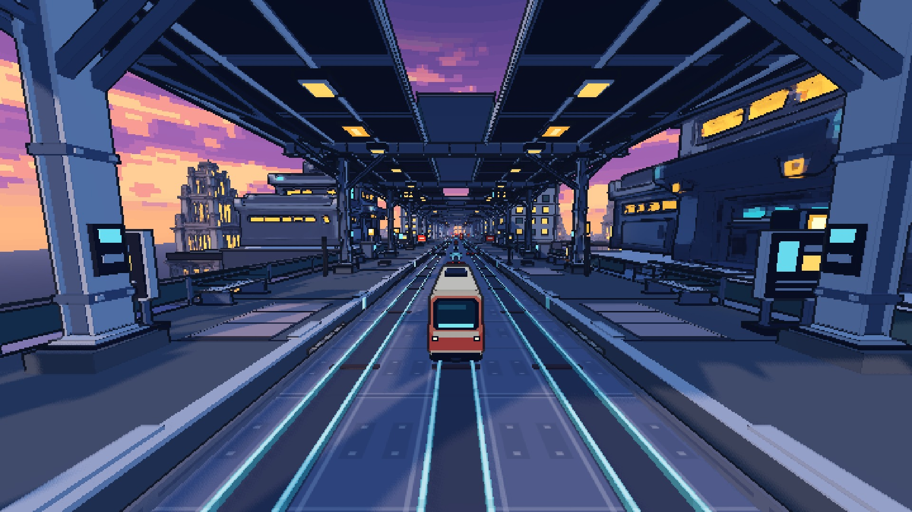 |
| [纸艺地图](games/train-parkour/styles/paper-atlas/) | R9完整峡谷路线 / 独立工程 | 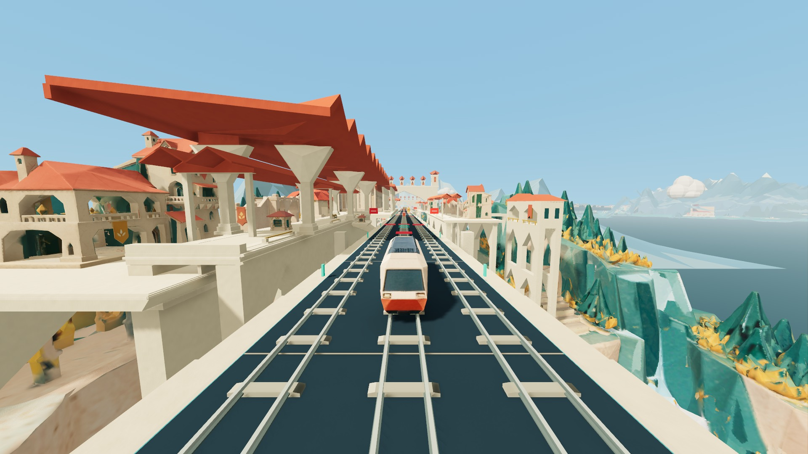 |
| [怪诞物流 B2](games/train-parkour/styles/odd-logistics/) | capture18＋suite03 / 9区全线候选 | 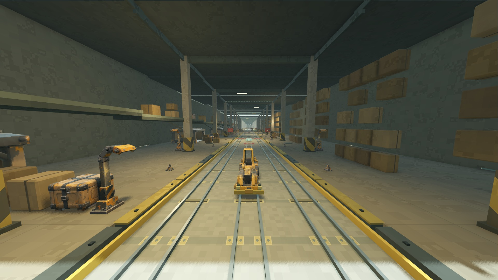 |
| [酸色漫画鬼节 H07](games/train-parkour/styles/halloween-comic/) | city08＋T2＋Festival V2＋列车修正 / 37轨9区 | 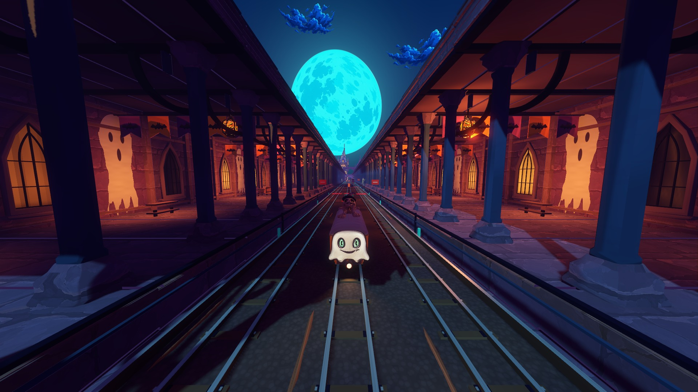 |

H07按并行制作模块核对集成；未完成的性能实验不覆盖已集成版本。准确的源版本、分支与运行结果见[万圣节集成矩阵](games/train-parkour/INTEGRATION_MATRIX.md)。

## 狗闹博物馆与 Bubble

| 游戏 / 风格 | 进度 | 原生开发截图 |
|---|---|---|
| [博物馆 A01 充气巡回博物馆](games/museum-dog/GAME.md) | 全馆装配；狗＋6名成人骨骼已接入，儿童/员工骨骼待制作 | 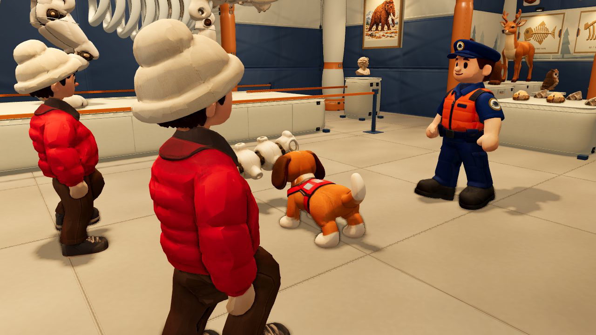 |
| [Bubble 新D1 拟人动物都市](games/bubble-buddies/GAME.md) | 整店r9、30个美术绑定；完整服务链美术验收待定 |  |

博物馆上图来自当前全馆骨骼测试场景，可复录的动态短片、夹具与[骨骼动画集成矩阵](games/museum-dog/INTEGRATION_MATRIX.md)随包提供。Bubble 新D1与旧D01是独立制作线；旧D01/D03/D05/D10收录方案、当前资格试装和对应模型，不当作4套完成的美术游戏。

## 下载与运行

使用 **Godot 4.7.2**。先取得完整 Release 工程，再打开所选 `project.godot`，等待资源导入。完整包内的相对资源链接指向包内共享资源；不要只移动某个风格子目录。

**同事无需切换到 `large-files` 分支。** 通过 Git 拉取 `main` 后，一条命令将全部模型、纹理、音频还原到当前工程目录；安装后可离线打开全部灰盒与美术工程，并继续通过Git增量更新源码：

```sh
git clone --single-branch --branch main https://github.com/hbzheng0942/greybox-to-multistyle-art-showcases.git
cd greybox-to-multistyle-art-showcases
python3 tools/download_complete.py --install-resources
python3 tools/launch.py
```

Release 分卷提供同一个完整ZIP。下载脚本会按顺序合并、校验每卷及完整ZIP的SHA256，已验证的分卷可续传；只需Python3标准库，无额外依赖。在源码仓库运行：

```sh
python3 tools/download_complete.py --extract --output ../showcase-complete
cd ../showcase-complete/greybox-to-multistyle-art-showcases
python3 tools/launch.py
python3 tools/launch.py hole orbital --import --godot /path/to/Godot
python3 tools/launch.py hole orbital --godot /path/to/Godot
```

`launch.py`列出可运行的`游戏ID 风格ID`。也可按各游戏说明直接在Godot编辑器中打开。Windows未启用符号链接时，下载脚本会将链接还原成独立文件，所需磁盘会增加。首次导入会产生本机缓存；缓存和引擎可执行文件不在交付包内。

发布采用小分片传输：独立 `large-files` 分支保存8 MiB片，GitHub Actions按清单与哈希拼接、复用已上传分卷，再生成完整Release。使用上面的单分支克隆命令即可避免同时拉取传输分片。详见[分片传输与校验](docs/LARGE_FILES.md)。

## 文件组织与工作留痕

```text
games/<game>/
  GAME.md                 游戏入口、操作、进度与限制
  styles.json             风格、版本与验证状态
  shared/                 游戏共用代码与资源引用
  styles/<style>/          各风格工程、装配与截图
  process/                方案、粗模、试装图与可编辑资产索引
  files-manifest.json     交付文件的内容哈希
shared/assets/sha256/      完整包内唯一资源库
catalog.json              跨游戏查询目录
docs/AGENT_HANDOFF.md      后续agents工作规则
```

后续增量更新需绑定源版本、模型哈希、实际运行结果与截图。用户验收和技术检查分别记录；录制发布素材时隐藏灰盒标注与调试面板，离线逐帧渲染不作为实时性能证明。
