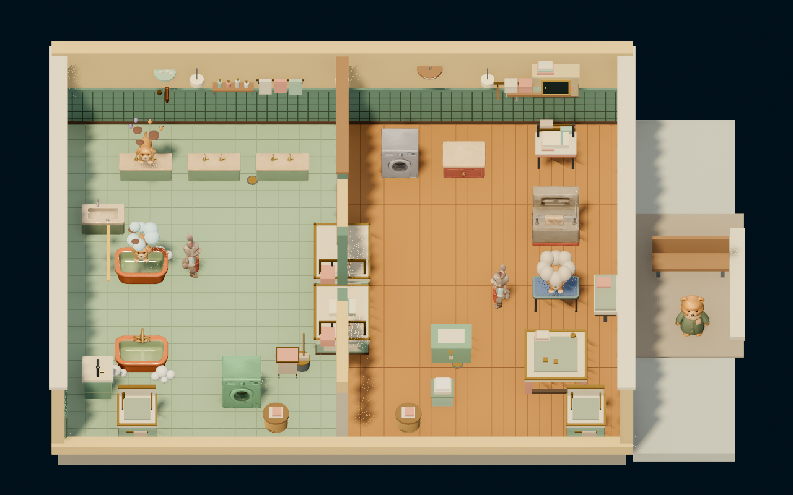

# Bubble Buddies / 泡泡搭档

Run a cooperative pet-care shop: receive pets, wash or groom them, pass items through the partition and return completed orders.

| Direction | Included | Progress |
|---|---|---|
| v9 greybox | `styles/greybox/play.tscn` | Accepted as the initial input for art production |
| D1 Animal City | `styles/d1-animal-city/play.tscn` | r9 whole-shop assembly; H4 evidence and visual signoff pending |
| D2 handcrafted / D3 cel dusk / D4 riso | Direction records only | Queued |
| Original D01/D03/D05/D10 | `process/original-lineage/` concepts, proxy, references, GLBs and qualification images | Earlier qualification, not completed styles |

Open `project.godot` in Godot4.7.2 and allow assets to import. Default is D1; run the greybox scene explicitly for the initial gameplay input. Shell: `godot --headless --editor --import --path games/bubble-buddies`; then `godot --path games/bubble-buddies`. The complete release archive supplies the model resources. D1 retains its Forward Plus lighting; a compatibility renderer changes its appearance.

Press1 for solo or2/Space for co-op. P1: WASD/E/holdF, Tab switches staff in solo. P2: arrows/K/holdL. Esc pauses; B toggles music; M mutes.

`shared/engine/` contains five identical gameplay/helper scripts reused by the two source lineages. v9 and D1 keep their actual differing controllers and visuals under their own source/entry areas. D1 assets, environment, material shaders and assembly manifest are style-owned.

The clean preview is an actual staged D1 native frame with all 30 bindings and no assembly errors. It does not prove complete service-loop/H4 acceptance. Original D01 and WorkBuddy D1 remain distinct.

Both playable entries default to clean recording presentation: `shared/showcase_clean.gd` suppresses prototype scene Label3D and gameplay overlay panels every frame while preserving the solo/co-op start and pause/continue menus. After starting a shift, the world remains clean; gameplay/input are unchanged. Append `-- --show-hud` to restore development UI, or `-- --showcase-clean` to explicitly select the default. The greybox command is `godot --path games/bubble-buddies res://styles/greybox/play.tscn`.

[Production process](process/INDEX.md) contains actual plan images, four replayable original S6 profiles, current qualification GLBs and native assembly checkpoints. Open GLBs directly in Blender after downloading the full archive. Process models stay outside automatic Godot import via `process/.gdignore`.

Integration rebases resources, replaces absolute system-font reads with SystemFont and routes optional playtest evidence to `user://`. Canonical sources remain unchanged. See `INTEGRATION.md` and `styles.json`.
