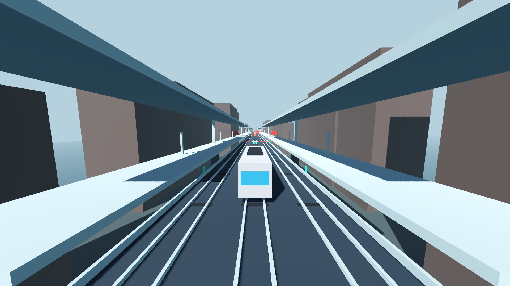

# Train Parkour

Five editable visual candidates and a separate playable greybox input share the same fast single-player train action: change lanes, release into the air, align with a receiving rail, and continue along the route. These are playable development examples; concept fidelity, stable performance and human final acceptance remain separate.

| Style | Included version | Progress | Native preview |
|---|---|---|---|
| Gameplay greybox / 玩法灰盒 | m1.7r2-unified-v2 | Pure input gameplay, no art overlay |  |
| Clay / 彩色黏土 | P21 | Historical playable art candidate |  |
| Pixel Skyline / 像素天际线 | V2 route finish, continuous + bold | Seven-node playable candidate; concept/art acceptance open |  |
| Paper Atlas / 纸艺地图 | R9 full-course refinement | Seven-node playable candidate; concept/art acceptance open |  |
| Odd Logistics / 怪诞物流 B2 | Full scene, capture18/suite03 source | N01–N09 playable prototype; visual and performance acceptance open |  |
| Halloween Comic / 酸色漫画鬼节 H07 | city08 + T2 + Festival V2 + train readability | Integrated 37-track, nine-region candidate; visual and performance acceptance open |  |

The incomplete A1 direction, rejected Cel Coast full-world art, old Pixel V1 and superseded engineering worktrees are excluded.

## Run or edit

Use Godot **4.7.2** and Python 3.10+. Obtain the complete release archive described in the [repository README](../../README.md); a source-only Git clone intentionally omits the large resource bytes.

```sh
python3 games/train-parkour/launch.py --list
python3 games/train-parkour/launch.py --style greybox --godot /path/to/Godot
python3 games/train-parkour/launch.py --style h07 --godot /path/to/Godot
python3 games/train-parkour/launch.py --style b2 --godot /path/to/Godot
python3 games/train-parkour/launch.py --style pixel --godot /path/to/Godot
python3 games/train-parkour/launch.py --style paper --godot /path/to/Godot
python3 games/train-parkour/launch.py --style clay --godot /path/to/Godot
python3 games/train-parkour/launch.py --style h07 --editor --godot /path/to/Godot
```

The launcher uses Vulkan, the recorded working backend for B2. Use `--renderer` to select an explicitly tested alternative on your machine. First import/build can take time. These examples include dense scenes and do not promise a target frame rate.

Space starts / releases at an eligible window. A/D steers or corrects in air. Shift brakes. R retries, Esc pauses, V changes comfort view, M toggles sound, 1/2/3 selects pace. H honks in H07. The clean default view hides the retained prototype HUD; add `--show-hud` when diagnosing controls or scores.

For direct Godot editing, main styles use `shared/engine-main/game/project.godot`; Paper uses `styles/paper-atlas/engine/game/project.godot`. Open the scene named in [styles.json](styles.json) and press F6. Main F5 defaults to H07; Paper F5 defaults to Paper Atlas. Both applications have their own Showcase save namespace.

## Integration and structure

[INTEGRATION_MATRIX.md](INTEGRATION_MATRIX.md) records the H07 component combination and excluded in-progress work. The stable source combination includes city08, original G1 environment assets, the T2 train, Festival V2 actors/actions, train face/buffer lighting and exact static batching. An uncompleted frame-rate experiment is explicitly excluded.

`case.json` identifies this case; `shared/engine-main/` contains one main engine/source root; `styles/` contains selectors, preview images and the necessary Paper R9 source variant. Paper shares unchanged source files with main through internal relative links. Large assets occur once in the repository-wide content-hash store. Godot's existing `game/`, `art/` and `tools/` resource relationships are preserved.

The native projects remain editable. The public adapter supplies launchable scenes, clean-view defaults and portable parameter selection; it does not change the route, collision, speed, solver or formal camera. Only runtime/source dependencies are included. Import caches, production/provider records, credentials and historical builds are excluded.

## Verification and agent handoff

See [validation/index.json](validation/index.json) for exact current package checks. H07's headless assembly/synthetic-input contract covers all 37 tracks across six branches and nine declared regions; rendering, game performance and human visual acceptance are separate checks. Preview screenshots are real native frames, not concept art.

Before editing this case, read [AGENT_HANDOFF.md](AGENT_HANDOFF.md), [styles.json](styles.json), the relevant style entry and [files-manifest.json](files-manifest.json). Preserve asset hashes and relative links. Keep future private source locations and working evidence outside the public repository.

Existing concept, early native assembly and editable component materials are indexed in [process/INDEX.md](process/INDEX.md) for local workflow recordings.
